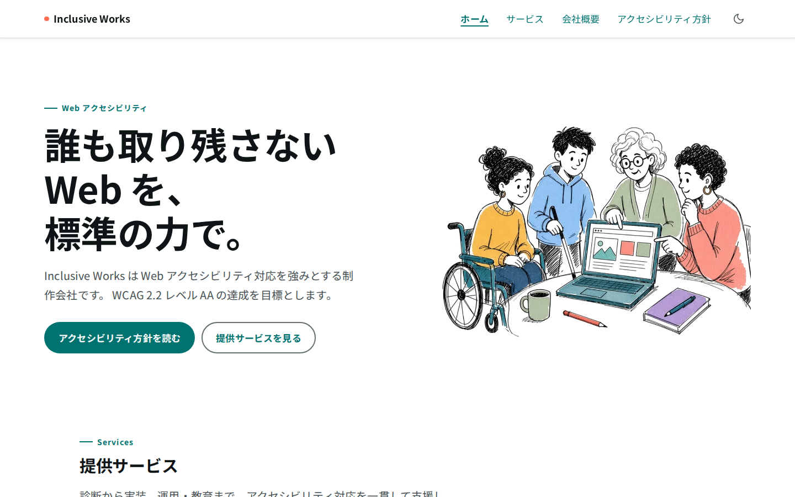

# Inclusive Works — コーポレートサイト

[](https://github.com/Naruse-alt/a11y-corporate-site/actions/workflows/ci.yml)

## 概要

Web アクセシビリティ対応を強みとする架空企業 **Inclusive Works** のコーポレートサイトです。  
実装の正しさと、「なぜそうしたかを説明できること」を同じ成果物として扱っています。

本番プレビュー: [https://a11y-corporate-site.naruse-works.workers.dev](https://a11y-corporate-site.naruse-works.workers.dev)（HTTP Basic 認証あり。資格情報はリポジトリに含めません）



## なぜ作ったか

EC サイトの構築・運用に関わるなかで、「誰にとっても使える UI」を後から足すのではなく、最初から品質として組み込む必要があると感じてきました。  
その感覚を、推測ではなくコードと検証手順で示せる形にしたいと考え、このコーポレートサイトを一から作りました。  
架空の会社設定にしていますが、ナビやフォーム、方針ページなど、実運用に近い画面で判断を残せます。

## アクセシビリティを大事にする理由

2024年4月の改正障害者差別解消法の施行で、民間事業者にも合理的配慮の提供が義務化されました。  
アクセシビリティは「余裕があればやる対応」から、プロダクトの基本品質へと変わりつつあると感じています。  
年齢も環境もさまざまな方が毎日使うプロダクトでこそ、この視点が活きると考えています。  
だから私は、見た目の美しさと同じくらい、届きやすさと説明可能性を大切にしています。

## アクセシビリティ方針

達成目標は **WCAG 2.2 レベル AA** です。国内の JIS X 8341-3（現行 2016 年版）についても、ISO/IEC 40500:2025（WCAG 2.2）との一致規格化を先取りする前提で設計しています。  
適合宣言は行いません。試験結果の公開も行いません。

自動チェックで拾える範囲（例: `scripts/contrast.mjs`、Playwright + axe による機械検出の回帰）と、スクリーンリーダーなど人手の確認が必要な範囲は分けて扱います。  
axe の違反ゼロをもってレベル AA 達成とは判断しません。

サイト上の方針文: [/accessibility/](https://a11y-corporate-site.naruse-works.workers.dev/accessibility/)

## 品質の確かめ方

Pull request と `main` への push で、GitHub Actions の [`.github/workflows/ci.yml`](.github/workflows/ci.yml) が次を順に実行します。

1. `npm ci`
2. `npm run check`（`astro check`）
3. `npm run build`（静的ビルド + CSP ハッシュ生成）
4. `workers/csp-policy.generated.js` のコミット差分チェック
5. `npm run contrast`（色トークンのコントラスト検証）
6. `npm run test:basic-auth`（Basic 認証ヘルパーのユニット検証）
7. Playwright Chromium の導入
8. `npx playwright test`（axe を含む a11y E2E、横はみ出し、CSP など）

デプロイやシークレット依存のステップは CI に含めていません。プレビュー／本番配信は Cloudflare Workers Builds 側です。

## 技術構成

| 項目 | 内容 |
| --- | --- |
| フレームワーク | Astro 7（`package.json` 上は `astro` ^7.4.2。静的出力。UI フレームワークなし） |
| 言語 | TypeScript（^6.0.3、`astro check`） |
| スタイル | 素の CSS + カスタムプロパティ（`src/styles/`） |
| フォント | Noto Sans JP Variable（セルフホスト） |
| Node.js | 24.22.1（`.nvmrc` / `engines.node` >=24.22.1） |
| 配信 | Cloudflare Workers（`wrangler` ^4.152.0、`wrangler.jsonc` + `workers/`） |
| E2E | Playwright + `@axe-core/playwright`（`e2e/`） |

## 見どころへの案内

- [/annotations/](https://a11y-corporate-site.naruse-works.workers.dev/annotations/) — 実装の解説（ページ／パーツ単位の判断）
- [`docs/decisions.md`](docs/decisions.md) — 設計判断ログ
- [`docs/keyboard-specs.md`](docs/keyboard-specs.md) — キーボード操作仕様
- `src/components/SkipLink.astro` / `SiteHeader.astro` / `form/ContactForm.astro` — スキップリンク、ネイティブ `<dialog>` ナビ、送信なしデモフォーム
- `src/styles/tokens.css` / `scripts/contrast.mjs` — 色トークンとコントラスト検証
- `e2e/` — CI と同じ回帰スイート

## ローカルでの動かし方

前提: Node.js 24.22.1（`.nvmrc`）。

```bash
npm ci
npm run dev
```

| コマンド | 説明 |
| --- | --- |
| `npm run dev` | 開発サーバー（`astro dev`） |
| `npm run build` | `dist/` へ静的ビルドし CSP ハッシュを生成 |
| `npm run preview` | ビルド成果物のローカルプレビュー |
| `npm run check` | Astro / TypeScript の静的診断 |
| `npm run contrast` | 色トークンの WCAG コントラスト検証 |
| `npm run test:basic-auth` | Basic 認証ヘルパーのユニット検証 |
| `npm run test:csp` | 生成 CSP とコミット済みファイルの一致確認 |
| `npm run test:e2e` | ビルド後に Playwright E2E を実行 |
| `npx playwright test` | 既存の `dist/` を前提に E2E のみ実行 |
| `npm run preview:cf` | ビルド後に `wrangler dev` |
| `npm run deploy:cf` | ビルド後に `wrangler deploy` |
